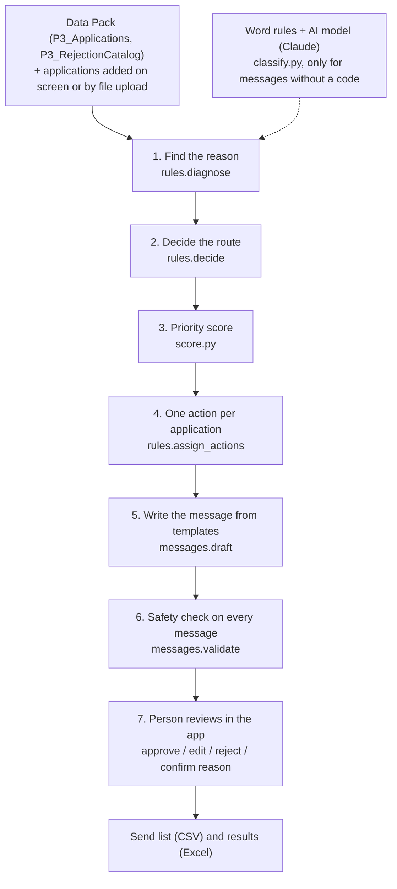

# ActivateIQ architecture

ActivateIQ helps the Razorpay onboarding team recover merchants whose applications stalled or were rejected. For each of the 75 applications that are not activated, it finds the reason, decides what should happen next, and writes a message in the merchant's preferred language. A person approves every message before it is sent.

**Principle: rules decide, AI explains, humans approve.**

## 1. Flow

Everything in steps 1 to 6 is plain Python rules. Given the same data, they always give the same answer. The AI model is used in one place only: as a second reader of rejection messages that come without a reason code.

## 2. Step by step

### Step 1: Find the reason (`rules.diagnose`)

| What the application has | What happens |
|---|---|
| A rejection code | The code is looked up in the rejection catalog. |
| A code **and** a message that disagree | If the message points to screening (R12) or a restricted category (R10), or the code is R10 and the message points to something else, the case is held for a person. Other disagreements are flagged for the person approving the message. |
| Only a rejection message | Word rules read the message, and the AI model reads it too. If they agree, that reason is **proposed**. If they disagree or the message is unclear, a person decides. |
| No code and no message | R13: the merchant just stopped. |
| A reason chosen by a person on screen | That reason wins over everything else. |

The same merchant twice (same business name and phone under a new ID) is also held, so the merchant does not get two messages.

### Step 2: Decide the route (`rules.decide`)

The checks run in this order, and the first one that matches wins:

1. Message unclear, or the case is held → **Manual review**
2. Reason read from a message, not yet confirmed → **Confirm reason**
3. R12 → **Route to compliance**
4. R10 → **Close application**
5. Everything else → **Fixable**

A fixable application is **recoverable** if the merchant was active in the last 30 days and has made fewer than 3 attempts. These limits are in `config.yaml`.

### Step 3: Priority (`score.py`)

Only recoverable applications are ranked. The score is:

`priority = log(1 + expected TPV) × recovery score ÷ effort`

- **Recovery score** is a rule of thumb, not a trained model, because the data has no outcomes. It goes down as days of inactivity and attempts go up, and goes up if the merchant has contacted support.
- **Effort** comes from the catalog's typical days to fix.
- **Expected TPV** is the merchant's expected monthly volume, not revenue that has been recovered.

### Step 4: One action per application (`rules.assign_actions`)

| Action | When |
|---|---|
| Route to compliance | R12 |
| Close application | R10 |
| Confirm reason | reason read from a message, waiting for a person |
| Manual review | unclear message, code and message disagree, or a possible duplicate |
| Send final nudge | fixable but not recoverable (inactive more than 30 days, or 3 or more attempts) |
| Call merchant | the 10 recoverable applications with the highest priority |
| Send resume reminder | recoverable R13 |
| Send fix nudge | other recoverable applications |

Follow-up plan: messages on Day 0, 3 and 7. Stop when the merchant resumes, or after 3 messages.

### Step 5: Write the message (`messages.py`, `templates.json`)

- Messages are filled in from fixed templates in 6 languages: English, Hindi, Hinglish, Tamil, Kannada and Marathi. No AI model writes them.
- The channel is WhatsApp only if the merchant opted in, and email otherwise.
- No message is written for Manual review or Confirm reason.

### Step 6: Safety check (`messages.validate`)

Every message is checked before a person sees it. The check catches:
- WhatsApp without opt-in;
- the wrong language or script;
- promises of approval, dates or waivers;
- screening words in compliance or closure messages;
- workarounds offered to restricted businesses.

On the How accurate is it page, 5 deliberately bad messages are run through the check to show that it catches them.

### Step 7: People decide (`app.py`)

- Nothing is sent without a person's approval.
- Only simple cases can be approved in bulk: fix nudges and reminders that passed the safety check and need no extra check.
- Calls, closures, compliance cases, held cases and reasons read from a message are handled one by one.

## 3. The AI model (`classify.py`, `compare.py`)

The AI model is Claude (`claude-opus-5-5`, low effort). It has three jobs, and it never decides on its own.

1. **Second reader of reviewer's messages.**
   - It must pick one of the catalog codes R01 to R12, so it cannot make up a reason.
   - On the Data Pack it agrees with the word rules on all 49 messages.
   - If the two disagree, a person decides.
2. **Live reading of new applications.**
   - When someone adds an application with a reviewer's message, the AI model reads it straight away, in any language or script. This includes Hindi and Tamil script, which the word rules cannot read.
   - The reason is proposed as "Confirm reason", and a person confirms it.
   - If the AI model is not available, the case goes to Manual review.
3. **Explaining a held case.**
   - On any case waiting for a person, the "Ask the AI model to explain" button gives up to 3 plain sentences: what the note most likely means, which code fits best, and what to check.
   - It also looks at the business name, type and industry, and says when R10 may apply (drugs or other illegal substances, gambling, weapons, adult content).
   - It is written for the onboarding team, never sent to the merchant. The person still chooses the reason.

**Guardrails:**
- Output is limited to catalog codes.
- The note is treated as data, and any instructions inside it are ignored.
- An explanation that names an unknown code, or is too long, is dropped.
- Errors and disagreements go to a person.
- The AI model never sends or closes anything.

A rule check also holds any application whose business name or industry looks like a restricted category (Manual review).

**Cost:**
- Each message is sent once. Answers are saved in `llm_answers.json`, and saved answers show straight away at no cost.
- One call costs about $0.01 (₹1).
- Set a monthly spend limit on the Anthropic console.
- Without a key, the app still works on saved answers and word rules.

## 4. Files

| File | What it does |
|---|---|
| `app.py` | The Streamlit app. Pages: Dashboard, Applications, Add an application, Why merchants stall, How accurate is it |
| `activateiq/load.py` | Reads the Data Pack and `config.yaml` |
| `activateiq/classify.py` | Word rules and the AI model for rejection messages |
| `activateiq/rules.py` | Reason, route, recoverable, action and channel |
| `activateiq/score.py` | Priority score |
| `activateiq/messages.py`, `templates.json` | Message templates and the safety check |
| `activateiq/pipeline.py` | Runs every step, builds the summary, writes the Excel output, spots duplicates |
| `activateiq/bulk.py` | Checks uploaded CSV or Excel files row by row |
| `activateiq/evaluate.py` | Accuracy checks: word rules, AI model, safety check, your gold labels |
| `activateiq/compare.py` | One-time AI model run |
| `config.yaml` | All limits: 30 days, 3 attempts, 10 calls, follow-up days, priority weights |
| `gold_labels.csv` | 30 cases labelled by hand, to test the app against |
| `tests/test_activateiq.py` | 31 automated checks (`python -m unittest -v`) |

## 5. What is stored

| File | Holds | Cleared by Reset |
|---|---|---|
| `data/added_applications.csv` | Applications added on screen or by upload | Yes |
| `outputs/decisions.csv` | Approve, reject and sent marks | Yes |
| `outputs/confirmed_reasons.csv` | Reasons chosen by a person | Yes |
| `gold_labels.csv` | Your hand labels | No |
| `llm_answers.json` | Saved AI model answers | No |

## 6. Scaling to 10,000 applications

- The rules are cheap. They run in seconds on 10,000 rows, with no AI cost.
- The AI model is only needed for messages without a code, and each unique message is paid for once.
- The queue for people stays small, because only unclear, held and high-value cases need a person. Simple messages are approved in bulk.
